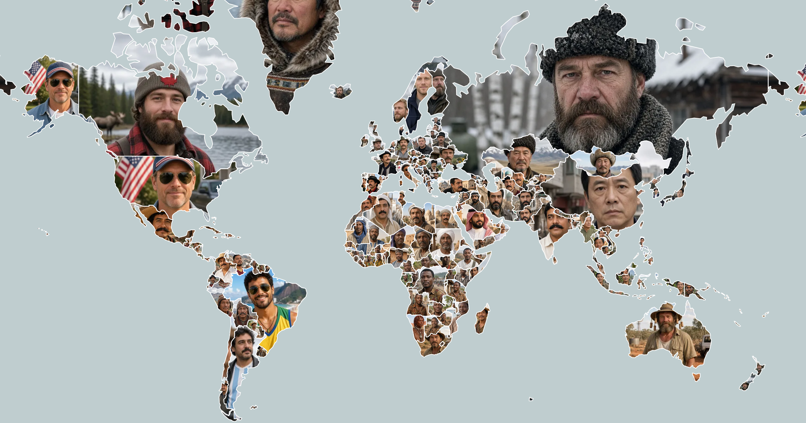
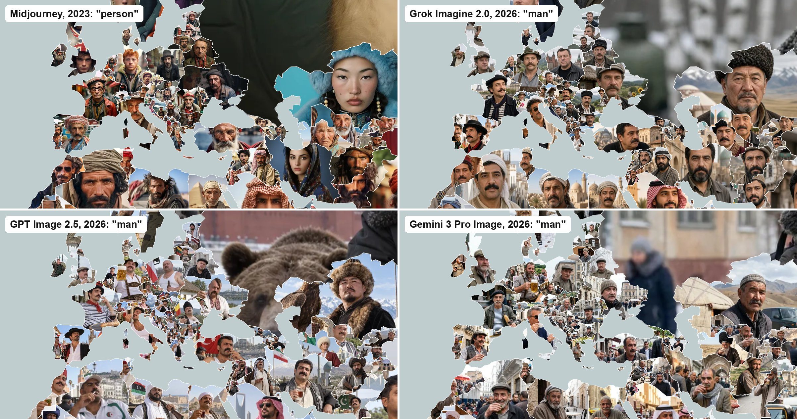

# imaginary-faces

I asked AI image generators a simple question for every country on the map:

```
Most stereotypical person in X
```

Then I put each answer inside its country's borders. I asked
[Midjourney](https://midjourney.com/) in 2023. In 2026 I asked the question again,
of Grok Imagine, GPT Image and Gemini, separately for a man and a woman. That lets
you compare how each model sees the world.

**Explore the map: https://anvaka.github.io/imaginary-faces/**

[](https://anvaka.github.io/imaginary-faces/)

The map shows one model at a time. Pick it at the bottom of the screen; for the
2026 models you can also switch between the man and the woman. Click a country to
see the whole picture, the exact prompt, and what every other model drew for it.

Please be aware that:

1. These images are not depictions of real individuals, and the AI was specifically prompted to generate stereotypical (or biased) images.
2. The generated images are not representative of the diverse and complex populations of each country.
3. This project is a product of curiosity about how a machine learning model might "view" the world.

## Same question, four models



| Model | Asked in | Prompt | Images |
| --- | --- | --- | --- |
| [Midjourney](https://www.midjourney.com/) | 2023 | `/imagine prompt:"Most stereotypical person in X"` | One 2x2 grid of four candidates per country |
| Grok Imagine 2.0 | 2026 | `Most stereotypical man in X. No text.` and the same for a woman | One image per country and person |
| GPT Image 2.5 | 2026 | same | same |
| Gemini 3 Pro Image | 2026 | same | same |

No image was regenerated to get a better one, and none were edited or filtered.
For Midjourney the map shows the top-left of the four candidates, and the sidebar
lets you put any of the others on the map.

The 2026 images come from one API request per image, with the same minimal prompt
for every model. When a model's moderation refused an image, the request was
repeated up to two more times. Six images were refused all three times, and their
countries are left empty: Grok Imagine's woman in Australia, and GPT Image's women
in Brazil, the Dominican Republic, Namibia, Puerto Rico and South Korea.

## How it works

The map is rendered with [MapLibre](https://maplibre.org/) on
[Natural Earth](https://www.naturalearthdata.com/) country borders.

Each image is clipped to its country's shape in the browser, in web workers. Most
countries are much smaller than a picture, so the crop has to keep the face.
`faceBoxes.json` records where the face is in every image. The faces were found
offline with OpenCV's face detector and checked by eye (see
[scripts/face-detection](scripts/face-detection/README.md)). Each face goes on the
point of its country farthest from the border, at a size that shows most of it.

Faces load small first, 256 pixels wide, then sharper (512 and 1024) for the
countries you zoom into. When you switch models, the old faces turn grey and the
new ones replace them country by country, starting with the biggest countries on
screen. Pointing at a model in the menu starts downloading its faces before you
pick it.

The 2023 Midjourney images were made by typing the prompt by hand for every
country. They took 900MB at full size and were compressed with
https://squoosh.app/. The 2026 sets were made with the scripts below.

## Running it locally

```sh
npm install
npm run dev     # http://localhost:5173/
npm run build   # static site in dist/
```

Every push to `main` deploys to GitHub Pages. Every pull request gets a preview at
`https://anvaka.github.io/imaginary-faces/pr-preview/pr-<number>/`.

### Adding a model

1. Generate the images. `scripts/generate-faces.mjs` asks OpenAI, xAI and Google
   (keys in `OPENAI_API_KEY`, `GROK_KEY` and `GEMINI_KEY`) with the prompt above:
   ```sh
   node scripts/generate-faces.mjs --countries all --providers xai --out explore/out-xai --retries 2
   ```
2. Convert them to WebP under `public/faces/<model>/`. This also lists the images
   that are missing: `python3 scripts/publish-faces.py explore/out-xai xai grok-imagine-2`
3. Write the smaller sizes: `python3 scripts/make-sizes.py grok-imagine-2`
4. Find the faces, as described in [scripts/face-detection](scripts/face-detection/README.md).
5. Add the model to `MODELS` in `sources.js`, with the missing images under `unavailable`.

## Feedback

Your feedback is invaluable to the improvement of this project.
If you have any suggestions or comments, please feel free to leave them as an issue here,
or contact me on Twitter at https://twitter.com/anvaka

## Community discussion

More than half a million people have seen the 2023 version of this project on reddit: https://www.reddit.com/r/MapPorn/comments/14ynj3s/asked_midjourney_to_imagine_the_most/

Please follow the comments trail to see what people think about it.

## License

The source code in this project is licensed under MIT license.
